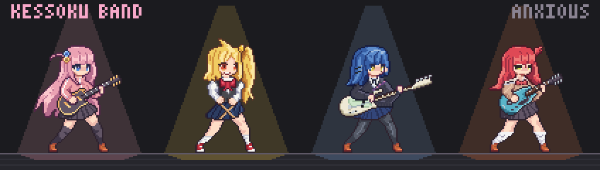

# Kessoku Ultimate Bocchi Theme

A *Bocchi the Rock!*-inspired mod for Claude Code. It dresses all of Claude Code in charcoal and pink, puts the
Kessoku Band on stage as animated pixel-art sprites, seats Claude's subagents with the band, and adds five themed
gags that each do a real job: **Cache Tax**, **Blast Radius**, **Filetree**, **Reflect** and **Replay Theater**.

Bocchi plays the main agent (the Claude you talk to). Nijika, Ryo and Kita take its subagents, by name or by what
they were asked, and Bocchi takes any they don't (see [How acts are seated](#how-acts-are-seated)). Every subagent is
a slime in its member's colour.



*The four of them in every mood, from the sprite studio. The live house itself is described under
[Kessoku Band panel](#kessoku-band-panel).*

Version 1.0.0, the Live Stage. Needs Claude Code 2.1.287 or newer (tested on 2.1.299; see [Notes](#notes));
`/bocchi help` shows the mod's version and the Claude Code it runs on.

## Quick start

At the prompt of a Claude Code terminal session:

```
/plugin install kessoku-ultimate-bocchi --marketplace Hnquangg123/kessoku-ultimate-bocchi
```

Answer `y` to add the marketplace, press Enter on the user scope, set the options (the defaults are fine), and the
mod is active in that session and every later one. From a shell, or in the desktop app where `/plugin` does not
run, see [Installing](#installing).

Then try three things:

1. **Put the band on stage.** `/kessoku` opens the panel (it opens by itself where there is room for a sidebar), and
   `/bocchi demo` puts five sample subagents (acts) on stage: playing, waiting, done and failed. `/bocchi solo ryo`
   opens Ryo's solo, every act of hers in full; `/bocchi demo off` clears the stage.
2. **Put on the theme.** `/bocchi theme on`. The mod also offers it once, on first run.
3. **Give the band real work.** Ask Claude: "have Ryo find where the config file is read", then watch a blue slime
   appear at Ryo's feet and the act land on her channel (a new song on the setlist, in the desktop app).

The gags have previews: `/bocchi crash` (the dropped guitar), `/bocchi tax` (Cache Tax), `/bocchi memo` (a band
memo) and `/bocchi setlist` (Replay Theater). `/bocchi help` lists every command.

## Words the band uses

- **Main loop**: the Claude you talk to, played by Bocchi.
- **Act**: one subagent, seated with one member. It is a slime at her feet, and a song on the desktop's setlist.
- **Set**: one turn of the main loop, numbered from the session's first (`set 3`).
- **Pit**: where the slimes stand, the live acts and those that ended in the last 30 s: at each member's feet on the
  desktop stage, one row for the whole band in a terminal.
- **Solo**: one member alone, with every act in full: her page on the desktop, her channel in a terminal. **The
  mix** is the whole band again.
- **Encore**: the 8 s after an act ends, while it takes its bow.

## New in 1.0.0

- **STARRY, the live house.** In the desktop app the Kessoku Band panel opens on a stage: the band at their
  instruments, a spotlight on whoever plays, each member's acts as slimes at her feet, then a chalkboard setlist where
  every act is a song. See [On the desktop](#on-the-desktop-starry-the-live-house).
- **A stage and a mixer in a terminal**: a marquee, the four heads, the pit, then a channel per member. See
  [In a terminal](#in-a-terminal).
- **Solo and encore.** Open one member alone ([Solo](#solo)), with **Auto solo** to do it for you. An act that just
  ended takes an 8 s bow: a sparkle and `✦ encore!` on the desktop, a bold line in her colour in a terminal.
- **Tracks, a neon sign, a band memo.** Tool rows read as numbered [tracks of the set](#tool-rows-as-tracks), the
  [strip above the prompt](#the-strip-above-the-prompt) is a neon now-playing sign on the desktop, and Nijika's
  [memo](#reflect-and-the-memo-tool) wears a backstage-pass stripe.
- **Moods.** Bocchi's melt is now a calm 5 s loop, and she also hides when a call is refused or the cache goes cold.
  See [Moods](#moods).

**Reference:** [Claude Code theme](#claude-code-theme) · [Skin](#skin) ·
[The band and its moods](#the-band-and-its-moods) · [Kessoku Band panel](#kessoku-band-panel) ·
[The strip](#the-strip-above-the-prompt) · [Cache Tax](#cache-tax-and-keepwarm) · [Blast Radius](#blast-radius) ·
[Filetree](#filetree) · [Reflect](#reflect-and-the-memo-tool) · [Replay Theater](#replay-theater) ·
[Notifications](#notifications) · [Commands](#commands) · [Keys](#keys) · [Settings](#settings) ·
[Installing](#installing) · [Tweaking and development](#tweaking-and-development) · [Notes](#notes)

## Claude Code theme

The mod ships two real Claude Code themes, so what Claude Code draws itself wears the band's colours too:
`Kessoku Bocchi` (`themes/kessoku-bocchi.json`) and its light twin `Kessoku Bocchi Light`
(`themes/kessoku-bocchi-light.json`). Both are listed in `/theme`.

They colour:

- the brand and the text
- the prompt border and its modes (permission, plan mode, auto-accept, bash, fast mode)
- success, error and warning
- the diffs, in dark green and rose tints that read under pink and white text
- the fullscreen backgrounds, selection and the usage meter
- the speaker labels, the eight subagent colours and the ultrathink rainbow

How to put it on and take it off:

- **The offer.** On first run, with the **Kessoku engine theme** option on, the mod asks once per machine in
  Claude Code's question dialog: `Yes, tune up` or `Not now` (`okay. /bocchi theme on any time`). It does not ask
  when the theme is already on or your organization locks the theme row.
- **`/bocchi theme on`** switches the `/config` theme row to `Kessoku Bocchi`, or to the light twin when your current
  theme is a light one, and remembers the theme you had.
- **`/bocchi theme off`** puts that theme back. It restores only a theme the mod itself replaced; otherwise it says
  `nothing to restore`.
- **`/bocchi theme`** (or `/bocchi theme status`) says which theme is on and whether Kessoku is listed in `/theme`.
- A theme row locked by your organization stays as it is.
- **The theme copy.** Where Claude Code does not list the mod's own theme, `/bocchi theme on` writes a copy to
  `~/.claude/themes/` (`kessoku-bocchi.json` or `kessoku-bocchi-light.json`; under `$CLAUDE_CONFIG_DIR/themes/` when
  that is set) and selects it. The copy stays after an uninstall; delete it there if you like.

## Skin

The mod restyles Claude Code's own transcript, spinner, footer, hint line and dialogs. How much is the
**Transcript skin** option.

**`full`** (the default) adds, on top of everything `light` does:

- a bar in the accent beside each prompt you type, and one in Bocchi's pink beside her replies (dim on a summary)
- a `♪` on folded tool groups (accent while active, rose at rest)
- the output of the mod's own commands in a rounded card titled `♪ /<command> <args>` (red on an error)
- `Nijika asks the band`, with her head, over the question dialog

**`light`** keeps to the small lines:

- the spinner's suffix: ` ♪` while a tool runs, ` ♫` while Claude responds
- with **Band spinner words** on (terminal only), a verb for what the turn is doing, such as `Tuning` while
  thinking, `Counting in` while requesting, `Plucking` while a tool's input streams, `Shredding` while a tool runs
  and `Wailing` while responding
- `♪ kessoku` among the footer's modes
- a band word closing each turn: `Encored for 3s`, `Jammed`, `Shredded`, `Soundchecked` and friends
- ` ♪` and Bocchi's face at the end of the hint line under the prompt, plus ` /bocchi help` between turns
- `let Ryo take it backstage` in place of Claude Code's `run in background` hint
- `♪ ` before info notices

**`none`** leaves all of these alone.

### Tool rows as tracks

With **Tool row cards** on `all`, every tool row gets a track header:

```
♪ 03 ·  Ryo  Read · hooks/register.tsx                          0:01
```

- The track number counts the main loop's calls from 1 each turn. A subagent's calls get none.
- The member's name sits on a tag in her colour.
- At the right: `playing` while it runs, `cut off` when interrupted, `wrong note` in red on an error, else the call's
  length.
- Edits (`♫`: Edit, Write, NotebookEdit) are framed in a rounded border: accent while playing, rose at rest, red on
  an error. Every other call is one header line over Claude Code's own row.
- An edit's result gets a `♫ setlist · <file>` card with Kita's verdict: `Kita approves · +12 -3`, or
  `Kita missed a chord`.
- The memo tool's row is Nijika's: `♪ kessoku memo · proposing a rule`, then `Nijika holds it for Save`.

`edits` keeps only the edit and memo rows; `none` leaves Claude Code's rows untouched.

Who a row names:

| Member | Tools |
| --- | --- |
| Nijika | Agent, Workflow, the Task tools, TodoWrite, AskUserQuestion, Skill, plan mode, ScheduleWakeup, SendMessage, ListAgents, the memo tool |
| Ryo | Grep, Glob, Bash, PowerShell, Read, WebSearch, WebFetch, ToolSearch, Monitor, LSP, MCP resources, worktrees, every `mcp__` tool |
| Kita | Write, Edit, NotebookEdit, the Artifact tools, SendUserFile, DesignSync, ClaudeDesign |
| Bocchi | everything else |

### The rest

- **Status line.** Bocchi's face and what she is up to: `<face> bocchi · <what she is doing>`. See
  [Moods](#moods).
- **Charcoal backgrounds** behind the mod's own panels and cards. Never painted on a light theme.
- **Accent** for borders and highlights. The default, `claude`, follows the active theme.
- **Restyle other mods** (off by default): other mods' bordered boxes with no border colour get the accent, and their
  uncoloured text the theme's text colour.

## The band and its moods

| Member | Plays | On the panel | Colour |
| --- | --- | --- | --- |
| Bocchi (Hitori Gotoh) | lead guitar | main agent · heavy tasks | pink |
| Nijika (Nijika Ijichi) | drums | coordinator · scheduling | yellow |
| Ryo (Ryo Yamada) | bass | background · refactors · db | blue |
| Kita (Ikuyo Kita) | vocals & rhythm | ui · frontend · docs | coral |

### Sprites

- 96x96 figures at the density of the reference art: Bocchi's standing pose is drawn from it pixel for pixel, and the
  band in the same hand. Each has seven poses, eight faces, box peeks and hair sway.
- 32x32 portraits, and a hand-drawn 16x16 mini head each for the terminal.
- Six moods each, each a short loop at ten frames a second, the band in step with Bocchi.
- Drawn in `studio/`, animated and rendered with Remotion, and shipped inside the mod as data. Nothing is fetched or
  rendered at run time.

Where they are drawn:

- **Desktop app, VS Code extension and mobile app.** The band stands on the live-house stage at 2x (3x once the
  stage is 900 px wide). The strip's sign carries one portrait and her page a 2x polaroid. The small spots (the
  dropped-guitar screen, Cache Tax, the memo, Replay Theater, the question dialog) draw a crisp animated picture.
- **Terminal.** Half-block pixels where there is room (a mini head in 16x8 cells, every colour kept) and quadrant
  blocks in the small spots (8x4), repainted ten times a second, only while a sprite is on screen. True colour shows
  them best.
- The status line and toasts take only text, so they keep the kaomoji.
- **Character art** set to `kaomoji` turns every picture off: text faces everywhere, no slimes.

### Slimes

Every act is a slime in its member's colours, 36x24, drawn from bead patterns. Bocchi's has her hair clips and two
faces on one body. The main loop is never a slime.

| State | When | Looks |
| --- | --- | --- |
| active | the act runs | bounces (Bocchi's wide-eyed) |
| idle | pending or waiting | breathes |
| asleep | completed, failed or stopped | breathes slower, a `z` drifting up |

A finished act stays in the pit for 30 s. On the desktop stage an act in its encore and a failure from this set are
drawn awake: the encore with a sparkle on its shoulder, the failure under a red ✗ bubble. In a terminal a slime is
its 18x12 mini (9x3 cells).

### Moods

Bocchi's mood shows on the status line, on stage and across the panel.

| Mood | Face | Her loop | When |
| --- | --- | --- | --- |
| anxious | `` (;´Д`) `` | a breathing idle with nervous glances | idle |
| focused | `( •_•)♪` | strumming, notes rising | a turn is running |
| happy | `(≧▽≦)` | a jump with sparkles | 6 s after a turn ends with an answer: `nailed it! 2:14 · 3 edits on the setlist (/replay)` |
| panic | `(ﾟДﾟ;)` | shaking, sweat flying | 8 s after a turn stops on anything but an answer or an interrupt; 5 s after one of the main loop's tool calls fails (`wrong note in Bash`); while Blast Radius holds a command; while Cache Tax holds a send |
| melting | `(x_x)…` | a calm 5 s sustained melt | context at 85 % or more; while the conversation is compacted, by `/compact` or automatically |
| hiding | `[(._.)]` | peeking out of a cardboard box | 8 s after you interrupt a turn; 6 s after a call is refused; while the cache sits cold between turns |

- **Refused** means you turned down one of the main loop's calls, or a hook refused it: `told no… hiding in the box`.
  The mod's own memo tool, calls another plugin makes, and anything while Blast Radius holds a command do not count.
- **Cold cache.** Checked each minute. Between turns, once the prompt cache has expired, she goes into her box:
  `the cache went cold… in the box till your next prompt`. Your next prompt brings her out, and so does `/clear`.
  She stays in across a reload.
- When a timed mood ends she goes back to melting (compacting, or at 85 %), focused (a turn running), hiding (the
  cache cold) or anxious.
- The melt is the one long mood, so it is calm: she stays about half melted all loop, her face and guitar above the
  puddle. A drop gathers and splats, she blinks and sags, then tries to pull herself up (guitar back, focus face on),
  fails and slumps back. (Before 1.0.0 she collapsed into a flat puddle and re-formed every 2.8 s.)
- `/bocchi mood <mood>` tries a face on the status line for 15 s.

The other three take their mood from their acts:

- focused while she has a live act
- through the 8 s encore of her latest act: happy if it finished, panic if it hit an error, hiding if it was stopped
- anxious otherwise

Only Bocchi melts on stage. The others' melt (a 2.8 s sink into a puddle and back) shows in the studio and the GIF.

## Kessoku Band panel

`/kessoku` toggles the pane `♪ Kessoku Band` (`Kessoku Band: the panel is on stage.`). Where no pane fits, the panel
is drawn compact above the prompt, with a `Hide` button. With **Panel on start** on, the pane opens by itself where
Claude Code seats it as a sidebar (144 columns, or 110 once you have opened it yourself); elsewhere a toast says
once: `/kessoku opens the band panel`.

### On the desktop: STARRY, the live house

Drawn in the desktop app, the VS Code extension and the mobile app, with **Character art** on `sprites`. Top to
bottom:

**The stage.** One picture that fills the panel's width at any zoom. It is a picture only: it takes no clicks and no
hover. To open a member's page use the buttons under the board, and for an act's details hover its song.

- A brick wall, a wooden deck and a carpeted drum riser. On the riser: Nijika seated behind her kit (a bass drum
  with the band's star, two rack toms, a floor tom, a snare, a hi-hat, a ride and a crash) and Ryo with her bass rig.
  On the deck in front: Bocchi by her half-stack and Kita at her mic stand.
- Above them: a truss of four light cans, string lights in the band's colours, the neon `Kessoku Band` sign with its
  star, and a `LIVE`/`OFF` lamp.
- A cone of light in her colour comes up on a member only while she plays: Bocchi while a turn runs, the others while
  they have a live act. With nobody lit, a warm house light fills the stage. An encore stays dark.
- The neon sign and the lamp (`LIVE`, red, breathing) are lit while a turn runs. Between turns the sign is a dark
  tube, with a glow behind it while someone plays. Nijika's cymbals glint while she plays.
- Each member's pit sits at her feet: one to three slimes (her live acts and those that ended in the last 30 s), then
  a `+n` badge. A failure from this set stays on stage under a red ✗ bubble; an encore wears a sparkle.
- A member in her box: the box stands where she stands, Nijika's behind the kit.
- The stage shows no clock, cost or tool, so it changes only when a mood, a light, a slime or the solo does, and its
  animations never restart on a tick. Under a reduced-motion setting its light effects stop (the sign's hum, the
  LIVE lamp's breathing, an encore's twinkle, the cymbals' glint); the band's own loops still play.

**The plates.** One per member: her name and spend, then her status: `♪ main loop`, `♪ 2 playing`, `⧗ 1 waiting`,
`✦ encore!`, `✓ 3 done`, `1 stopped`, `in her box` or `resting`, and always `✗ 1 failed` in red. `ctx N%` shows
while she plays, and always (in red) past 85 %.

**The chalkboard setlist.** The head reads `Setlist`, `set N` and the session's cost. Then one song per act:

- a chalk mark: `♪` playing, `⧗` waiting, `✓` done (with a sparkle through its encore), `✗` failed, `—` stopped
- the title in her chalk colour, up to three lines, with the time at the right: `0:48` while it plays, `ran 2:40`
  once it ended
- a context bar (red past 85 %), the cost, whose song it is, and `now Grep` or `last Read`
- the main loop's song is titled by the prompt that started the set, and labelled `main loop`; before the first set
  it reads `the main conversation`

The order is the main loop while it plays, then playing, waiting, this set's failures, then the rest, newest first.
Eight songs at most; the rest fold into one line at the foot.

A failed act gets a red ✗, a wavy red underline, its reason on a line of its own (its own error, `ended in an error`
or `refused to go on`) and a tilted `FAILED` stamp. An act that hit a tool error and carried on gets an amber
`⚠ last error: …` line instead: it did not fail.

The foot shows `main ctx`, `limit N%` (when there is a rate-limit figure) and the cache (`warm, 48m left`,
`cold for 12m`, `kept warm, 5m left`, `no cache yet`), over a chalk tray. A solo page with no songs on it says the
band is tuning up.

**Hover a song** for its details: the whole title, its tools by count with tally strokes, the model
(`sonnet 5.5 · 7 steps · 12.4k tokens`), the act's type and when it ran (`started 0:48 ago`,
`ended at 3:42 of the 6:02 set`), and a button, `Open on Ryo's page →`, which opens her solo with that act first.
The main loop's song has no button.

**Buttons** under the board: one per member, labelled with her name (hotkey `b`, `n`, `r` or `k`); `Back to the mix`
(`m`) on a solo; `Hide` (`h`) above the prompt. Above the prompt the stage is left out and the board lists three
songs.

With **Character art** on `kaomoji`, the desktop draws the terminal's layout below, with text faces.

### In a terminal

Top to bottom:

- **Marquee.** `♪ KESSOKU BAND ♪`, then `● ON AIR` (white on red) while a turn runs or `○ OFF AIR`, then
  `set 3 · 2:14` or `no set yet`. On a solo, `solo: Ryo` at the right.
- **Stage.** The four mini heads over a `▔` line: half blocks where the pane is roomy (76 columns and 34 rows),
  quadrants elsewhere. Under each head, her name on a tag in her colour, `×2` while she has two acts live, and her
  context as a meter (Bocchi's is the main loop's; the others show their fullest live act's). There are no spotlights
  here; on a solo the other heads dim.
- **Pit.** One row of up to six slime minis from the whole band, then `+n`. Under it, each member's initial with a
  numbered button per act (`1`, `2`, …) that solos her with that act first.
- **Mixer.** A channel per member, two to a row (one to a row below 60 columns or above the prompt), framed in her
  colour, dim while she rests. Each channel has:
  - a VU column, lit to her share of the session's spend in eighths (the top two red at 7/8 or more)
  - her name as a button (`b n r k`), and her state: `playing, head down`, `2 playing`, `set done` or her mood line
  - for Bocchi, the main loop first: the set's current task and its cost, then `ctx ▰▰▱▱▱▱ 34%` with its tokens in
    and out
  - her acts, live first: `♪ Find every call site of legacyQuery()` with its age and `≈$0.04` at the right, then
    `ctx ▰▰▱▱▱▱ 18%`. Marks: `♪` live, `✖` failed or hit a tool error, `◌` stopped, `✓` done. Three acts for Bocchi
    and four for the others (one and two above the prompt), then `+ n more`.
- **Encore.** For 8 s after an act ends, its line is bold in her colour with `encore! · 2:40 · ≈$0.11` at the right.
  A failed one reads `wrong note · 2:40` in red.
- **Keys row.** `solo b n r k`, a `mix` button (`m`) on a solo, and `Hide` (`h`) above the prompt.
- **Rail.** `CTX ▰▰▰▱▱▱▱▱▱▱ 34%` (red at 85 %) · `PLAN` (the plan's fullest rate-limit window, only when there is
  one) · `GATE $0.42` (the session's cost) · `AMP` and the cache (`● keepwarm 2h00m`, `❄ cold`, `☀ warm 48:00`,
  `○ no cache yet`) · `3 on stage`.
- `✖ last wrong note: …` in red when there is one, and the footer
  `cost ≈ list prices × tokens, not your bill · /kessoku toggles`.

With `kaomoji`, each slot is her face (red in a panic, grey while melting) over her tag and meter, and her pit is
glyphs: `♪` live, `✖` error, `✓` done.

### Solo

One member alone, every act in full.

- **Open it:** her name button, or her letter (`b n r k`) while the panel has the focus; an act's number under the
  pit (terminal) or `Open on <Name>'s page →` (desktop), which list that act first; `/bocchi solo <member>` from the
  prompt; or **Auto solo**.
- **Close it:** her button again, `m` (`Back to the mix`, `mix`), `/bocchi solo off`, or `/clear`.
- **When it closes by itself:** 8 s after the last of her acts ends, once none of hers is still playing. Bocchi's
  closes that way only when an act seated with her ends while no turn runs; the end of a set does not close it. A
  solo on a member with no acts stays until you close it, and a new act of hers (for Bocchi, a new turn) keeps a solo
  you chose open.
- **On the desktop** a solo is her page:
  - the head reads `Ryo’s page` with `bass · background · refactors · db`, a summary
    (`3 acts · $0.31 · 1 playing · 2 done`) and her portrait as a 2x polaroid
  - her songs only (Bocchi's are the main loop and her own acts), each expanded with its details
  - `also tonight` at the foot, with how the others are doing
  - on stage only her cone is up, a little wider; the other three are darkened
- **In a terminal** her channel runs across the console beside her figure:
  - up to eight act cards, each with the act, its type, `encore!` or why it stopped, its age, a ten-step context
    meter, tokens, cost, when it started or ended, its top six tools (`Grep ×4 · Read ×3`) and `now: <tool>`
  - the other three folded to one line each
  - `r or m: back to the mix` (her own letter) to say the way out
- **Auto solo** (off by default): when a member takes a new subagent, her solo opens for 10 s with that act, then the
  mix returns. It never cuts short a solo you chose.

### The band as subagent types

The band is also three subagent types Claude can delegate to by name, registered at each session start and listed
beside general-purpose, Explore and Plan. Bocchi has none: she is the main loop.

| Type | For | Tools | Gives back |
| --- | --- | --- | --- |
| `kessoku-ultimate-bocchi:nijika` | plans, reviews, triage, summaries | Read, Grep, Glob, WebSearch, WebFetch | a numbered plan or a verdict with `path:line`; edits nothing, runs nothing |
| `kessoku-ultimate-bocchi:ryo` | searches, shells, tests, lint, type checks, "find where X happens" | Read, Grep, Glob, Bash, PowerShell, WebSearch, WebFetch | short lines with `path:line` |
| `kessoku-ultimate-bocchi:kita` | edits to named files: docs, README sections, UI copy, comments | Read, Edit, Write | every file she touched; she stops rather than guess |

- The short spelling `kessoku:ryo` works too.
- Ryo changes nothing unless the task names the exact command. That is a rule in her prompt, not a limit on her
  tools: she has Bash and PowerShell.
- Each prompt asks for a self-contained final message.
- On a Claude Code too old to register agent types they are off, and `/bocchi help` says so.

### How acts are seated

- **By name.** An act of a band type sits with its member. The toast reads
  `<Name> takes the stage: <description> (seated by name: <type>)`.
- **By what it was asked.** Any other subagent is scored by keywords in its description and the first 600 characters
  of its prompt:
  - **Nijika:** plan, coordinate, schedule, organise, orchestrate, review, verify, audit, triage, manage, outline,
    roadmap, checklist, workflow, summarise, status report.
  - **Kita:** ui, ux, frontend, css, tailwind, react, vue, svelte, next.js, component, layout, style, theme, design,
    docs, readme, markdown, changelog, artifact, web page, html, landing, website, tooltip, modal, button,
    accessibility, a11y, i18n, localise, screenshot.
  - **Ryo:** refactor, rename, migrate, database, db, sql, postgres, sqlite, mysql, redis, query, schema, index,
    background, cleanup, dedupe, duplicate, optimise, perf, benchmark, tests, lint, typecheck, tsc, search, grep,
    find, locate, explore, scan, crawl, inventory, dependency, upgrade, bump.
  - A Plan type adds 3 to Nijika; an Explore type adds 2 to Ryo, and so does a background run. The highest score
    wins, ties going to Nijika, then Kita, then Ryo.
  - With no score at all: Plan goes to Nijika, Explore or background to Ryo, anything else to Bocchi.
- Acts are seated when Claude Code spawns them. Any the mod missed are picked up from Claude Code's own list every
  2 s.

## The strip above the prompt

A line of the band sits above the prompt whenever nothing else needs that spot. Its `Hide` button hides it until
`/bocchi strip` brings it back.

**On the desktop** (with **Character art** on `sprites`) it is a neon now-playing sign, one image:

- `Now playing` in neon script, framed in the playing member's colour on a brick wall, with `set 3 · $0.42` at the
  top right
- her portrait, her name, the act's title (two lines at most), and `now Grep · 0:48 · ctx 18% · $0.04`
  (`main loop · …` for Bocchi's)
- at the right, who else is on stage (`+ Nijika ×2 ⧗ · Kita`), and a red pill naming who failed (`✗ Kita failed`,
  `✗ 2 failed: Kita, Ryo`)
- it shows the newest running act across the band, or Bocchi's main loop while a turn runs with none. A background
  act still running between turns keeps the sign up.
- Between sets it is a warm `Between sets` sign: `set 3 · $0.42`, the failure pill and its reason, then
  `The band is tuning up` with the main context, the cache and the plan's limit.

**In a terminal**:

- where there are rows to spare, the four mini heads in quadrants (only Bocchi's below 90 columns), and beside them:
  - `● ON AIR · NOW PLAYING · Ryo · Find every call site of legacyQuery() · 0:48` (`○ OFF AIR` between turns). With
    no act running: Bocchi and her current task while a turn runs, `backstage · set 3` between turns.
  - `3 slimes on stage (2 playing, 1 waiting) · $0.42 · cache warm 48:00`
- with seven rows to spare, a row of slime minis under the heads: the live acts and those that ended in the last
  30 s, up to six, then `+n`
- without room for the heads, or with `kaomoji`: one line, `♪`, the four faces (with names from 90 columns), then
  `│` with what is on stage, the session's cost and the cache.

Buttons, on both: `Replay 3` (`r`; when the last set left edits and Replay is not open), `Panel` (`k`; opens or
closes the panel) and `Hide` (`h`).

**Who gets the spot above the prompt**, highest first:

1. Claude Code's feedback survey
2. the dropped-guitar screen, when a held command got no pane
3. the Cache Tax warning, while a held prompt is under 15 minutes old
4. Nijika's memo
5. Replay Theater or the Filetree, opened above the prompt
6. the panel, drawn above the prompt
7. nothing, while the strip is hidden
8. the strip

Under Replay Theater, the Filetree, the panel and the strip, other mods' drawings above the prompt stack below the
mod's.

## Cache Tax and keepwarm

The prompt cache lives for a while after each turn (its TTL, time to live: 5 minutes or an hour). Send after it has
lapsed and the whole context is written to the cache again, at the cache-write rate. Cache Tax tells you before you
pay.

**The hold.** When the cache has gone cold, the next prompt you send is held once, and Bocchi panics:

- `CACHE TAX · the cache went cold 12:04 ago!!`, the tokens it would re-write, the rate, the cost, and what a warm
  turn would have cost
- your prompt is back in the box: Enter sends it (the same prompt sent again within 15 minutes passes)
- `Keep it warm after (6h00m)` (`w`) arms keepwarm, `Start fresh (/clear)` (`f`) puts `/clear` in the box,
  `Dismiss` (`d`) takes the card down
- it holds only a person's prompt, between turns, with someone at a screen, once the cache has been warmed, and at
  20,000 context tokens or more

**The price.** Claude Code's own estimate after a model switch, while the model still matches; otherwise list price ×
context tokens at the TTL's write rate (2× input for a one-hour cache, 1.25× for five minutes). A `~` before the rate
means only the model family's catch-all price matched.

**The TTL.** The **Cache TTL** option, 60 minutes by default (5 suits a plain API key). Left at 60, it gives way to
the TTL Claude Code reports on a model switch.

**Before it lapses.** Once per warm period, while the session is idle, without keepwarm, with 20,000 context tokens
or more, and 5 minutes left (or half the TTL, if that is shorter):
`Cache Tax: the cache goes cold in <time> · re-writing N tokens would cost ≈$x · /keepwarm keeps it warm`, as a
[notification](#notifications), or a toast where none went out.

**`/keepwarm`** keeps it warm with cheap pings:

- `/keepwarm` alone arms it for the keepwarm default (6 h). A length works too: `90m`, `2h`, `1h30m`, `1h30`
  (1 h 30 min), `1m30` (1 min 30 s), `1.5h`, or a bare `90` (minutes). `/keepwarm off` (or `stop`) ends it.
- Each minute, while it is armed, the session idle and not compacting, with 1,000 context tokens or more and the
  cache in its last 90 s, it sends a tiny side request built on the conversation (a fork):
  `Kessoku keep-warm ping. Reply with one word: ok`.
- A cache that already lapsed is not pinged: the next send warms it. A ping that found the cache cold says so in a
  toast, with what the re-write cost.

**`/cache-tax`** shows where things stand: warm with its time left, or `COLD` and for how long; the TTL; the context
and the model; what a cold and a warm send would cost; keepwarm with its time left, its pings so far and their cost.

**After a compaction** the tax starts over from the truth: the new transcript has no cache entry yet, the next write
is priced at the compacted size, and the panel's context reads the compacted set, so no stale figure or wrong
warning survives `/compact`. Nijika says `the set is compacted: X → Y tokens`.

`/bocchi tax` previews the warning; nothing is held.

## Blast Radius

Blast Radius (the guard) holds a risky shell command behind the **dropped guitar** screen, listing what would go,
until you answer.

**Held**, in Bash:

- deletes: `rm` recursive, or `rm -f` on several targets or a glob; `rimraf`, `del-cli`, `trash`, `trash-put`,
  `shred`, `unlink` (also through `npx`, `bunx`, `pnpm dlx`, `yarn dlx`); `xargs rm`; `find -delete` or
  `find -exec rm`
- git: `git reset --hard`, `git clean` (not `-n` or `-i`), force pushes (`--force`, `-f`, `+ref`,
  `--force-with-lease`), `git checkout -- <paths>` or `git checkout .`, `git restore <paths>` (not `--staged` alone),
  `git checkout --force`, `git switch -f` or `--discard-changes`, `git worktree remove --force`, `git stash drop` or
  `clear`, `git branch -d` or `-D`
- containers and infrastructure: `docker system prune`, `docker volume prune`, `docker volume rm`,
  `docker compose down -v`, `docker rmi -f`; `terraform`, `pulumi` or `cdk destroy`; `kubectl delete`,
  `helm uninstall`; `aws s3 rm` or `rb`, `gsutil rm` or `rb`, `az storage blob delete`
- databases: SQL `DROP TABLE`, `DROP DATABASE`, `DROP SCHEMA` and `TRUNCATE TABLE`; migrations (alembic,
  `rails db:migrate`, `db:rollback`, `db:reset`, `db:drop` and `db:schema:load`, `prisma migrate` and `db push`,
  `manage.py migrate`, knex, artisan, `dotnet ef`, goose, flyway, liquibase, dbmate, sqlx, migrate)

In PowerShell: `Remove-Item` and its aliases (`ri`, `rm`, `rmdir`, `rd`, `del`, `erase`) with `-Recurse` or `/s`,
or with `-Force`, `/q` or `/f` on several targets or a glob; a piped `Remove-Item`; the same git and SQL risks; and
the plainer migrations (any `migrate` argument, `manage.py migrate`, `prisma migrate`, `dotnet ef database update`).
The container, infrastructure and cloud-storage rules are Bash's only.

**Looked through:** `sudo`, `VAR=value`, `env`, `nohup`, `time`, `exec`, `timeout`, `nice` and the like, subshells
and groups, `cd`, `pushd` and `popd` (to know the folder), `sh -c` and `bash -c` and their friends, a heredoc fed to a
shell (`bash <<EOF`), `eval`, `wsl`, `cmd /c`, `powershell -Command`, and in PowerShell `Invoke-Expression`.

**Left alone:** heredoc bodies not fed to a shell, quoted text and comments; read-only commands whose words merely
mention `migrate` or `DROP TABLE`; dry runs and previews (`--dry-run`, `--check`, `--plan`, `--pretend`, `-WhatIf`,
`-Confirm`, `migrate status`, `git clean -n`, `git push -n`, `git restore --staged`); and `rm` without `-r` (a
single-file `rm -f`, a plain `rm`).

**Measured:**

- a delete's targets are expanded (`~`, globs) and walked through Claude Code's file system, with no shell: files and
  bytes counted up to 5,000 files, up to 10 listed
- `git clean` through `git clean -n`; a reset, checkout or restore through `git status --porcelain` and
  `git diff --shortstat`; a force push lists the commits it would drop, as of the last fetch
- migrations and the rest are not measured, and the screen says so; nor are targets that come from `xargs`, `find`,
  a pipeline or shell expansion

**The screen** (`⚠ Dropped guitar`): `DROPPED GUITAR · <label>`, the `Command`, what it `Would` do, Bocchi panicking
beside her guitar hitting the stage, the paths, a note, then `Cancel — catch it!` (`0`, with the focus) and
`Proceed — let it fall (p)`. Esc cancels. As its hint says:
`a letter never fires from the prompt, so a stray digit can't let it fall`.

- Cancel, Esc, closing the screen, no answer within 10 minutes, or an interrupted turn refuses the command. The model
  is told what it would have done, and `Do not retry it unless the user asks you to.`
- Proceed lets it run: `the guitar fell. running: <label>`.
- One hold at a time: a second risky call waits for the first. Other toasts wait while the screen is up, and a
  [notification](#notifications) says what is held.
- If Blast Radius itself fails while judging a risky command, the command is refused.
- It holds only where someone can answer. A headless run with no screen is left to your own permission settings.

`/bocchi crash` previews the screen for 20 s, with a sample `rm -rf build`. Or ask Claude to `rm -rf` a scratch
folder.

## Filetree

`/filetree` toggles the pane `♪ Filetree`: the project's files, lit up as Claude works.

- The files come from `git ls-files --cached --others --exclude-standard`, or, without git, a walk five folders deep
  that skips build output, caches and editor folders. At most 600, never under `.git`, `node_modules` or
  `.claude-plugin`.
- **Editing:** the file shimmers pink (for up to 100 s).
- **Edited:** it glows pink for 25 s, then stays rose, `edited · awaiting a commit`, for up to 6 h.
- **Read:** it glows blush for 8 s.
- **Committed:** a successful `git commit` (through Bash or PowerShell, not `--dry-run`) turns every edited file
  neon green for 90 s: `committed! 3 files lit neon green`.
- While a file is being edited, and for its 25 s glow after, its row names the member who touched it, with her face.
- Buttons: `Refresh` (`f`), `Close` (`c`). Legend: `pink = editing · rose = edited · green = committed`.

## Reflect and the memo tool

**A correction becomes a band memo.** Say "no, in this repo we use pnpm" and Nijika puts a memo above the prompt
offering to save the rule.

- What counts as a correction:
  - 8 to 1,500 characters, not a command (starting with `/`, `!` or `#`) and not a question (ending in `?`)
  - a strong telling-off, or two of: an opener (`don't`, `always`, `in this repo`, …), a pair (`X, not Y`,
    `A instead of B`), a subject (a tool, a style, this repo)
- One tiny Haiku call drafts the rule (`Nijika is scribbling a band memo…`). When it finds no rule, no card shows.
- The card: Nijika's yellow stripe, the `BAND MEMO` tag, `Nijika · "no, in this band we do it like this"`, the rule,
  and `Save to ./CLAUDE.md` (`s`), `Global instead` (`g`), `Edit` (`e`) and `Skip` (`k`). A saved rule shows
  `✓ saved to <path>: <rule>` for 6 s.
- **Save** writes the project's `CLAUDE.md`; **Global** writes `~/.claude/CLAUDE.md` (under `$CLAUDE_CONFIG_DIR` when
  that is set). The rule lands once under `## Band notes (from Reflect)`, with the file's own line endings.

**Claude can propose a rule itself**, through the memo tool `mcp__kessoku-ultimate-bocchi__memo` (`rule`, and an
optional `why`), when it catches itself breaking a convention.

- The same card, signed `proposed by Bocchi mid-set` (or the member whose act proposed it). No Haiku call.
- A rule must be one line, one sentence, under 140 characters, or it is sent back with why. A duplicate is
  `already held`. Up to five proposals wait behind the card on screen. With nobody at a screen, the tool refuses.
- The tool tells Claude the rule is held: nothing is written until you press Save.

The **Reflect memos** option turns both doors off. `/bocchi memo` previews a memo (Save really writes), and
`/bocchi memo proposed` a proposed one.

## Replay Theater

After a turn that left edits (Edit, Write or NotebookEdit, by the main loop or its subagents), the strip offers
`Replay 3`. When the turn ended with an answer, a dim `/replay 3 tracks` also sits in the empty prompt box: Tab takes
it.

`/replay` opens the pane `♪ Replay Theater` on the last setlist:

- `♪ REPLAY THEATER · setlist #N`, `track 2 of 3`, a chip per track
- who played it (her head), the file, the tool, a note (`new file`, `rewrite`, `replace all`, a notebook cell,
  `large rewrite`) and `+a -d`
- a unified diff with the file's real line numbers, up to 14 lines, then `… n more lines`
- `◀ Prev` (`p`), `Next ▶` (`n`), `Close` (`c`); Esc closes it too

A setlist holds up to 40 tracks, each kept to 120 diff lines. `/bocchi setlist` previews a two-track sample.

## Notifications

Three things go to your own notification channel, each titled `Kessoku Band`:

1. Blast Radius holding a command:
   `Blast Radius is holding <label>: it would <summary>. Answer the dropped-guitar screen.`
2. A set of 30 seconds or more that ended, unless you interrupted it:
   `Nijika: the set is done after 2:14 · 3 edits on the setlist (/replay)`, or
   `Nijika: the set stopped on <reason> after 2:14`.
3. The cache about to go cold (see [Cache Tax](#cache-tax-and-keepwarm)). Only this one falls back to a toast when no
   notification went out.

The channel is the one `preferredNotifChannel` names: `iterm2`, `iterm2_with_bell`, `kitty`, `ghostty`, or
`terminal_bell` (which rings and shows no text); `auto` takes your terminal's. Your own Notification hooks run first
and see each one. Nothing reaches a channel where there is no terminal (the desktop app, a `-p` run, the SDK: there
your Notification hooks alone run), where `auto` finds no terminal that notifies, or with notifications disabled.

**Toasts** follow the **Toasts** option. `all` shows every toast, chatter included (a member taking the stage,
finishing or stopping, a compaction, the panel hint). `important` keeps Blast Radius, commits, the theme and the
cache warnings, and the notifications still go out. `none` silences the toasts and the notifications.

## Commands

| Command | What it does |
| --- | --- |
| `/kessoku` | Toggle the Kessoku Band panel |
| `/filetree` | Toggle the Filetree pane |
| `/replay` | Step through the last setlist's edits (words after it are ignored, so the suggestion runs as is) |
| `/keepwarm` | Keep the cache warm for the keepwarm default (6 h) |
| `/keepwarm 90m` | Keep it warm that long: `90`, `2h`, `1h30`, `1.5h`, … |
| `/keepwarm off` | Stop keepwarm (`stop` works too) |
| `/cache-tax` | Is the cache warm, and what would a cold send cost? |
| `/bocchi help` | The mod's and Claude Code's versions, every command, and what is off on this Claude Code (`/bocchi` alone too) |
| `/bocchi theme on` | Put on the Kessoku Bocchi theme, or its light twin (`apply` works too) |
| `/bocchi theme off` | Put back the theme it replaced (`restore` works too) |
| `/bocchi theme` | Which theme is on, and whether Kessoku is listed (`status` too) |
| `/bocchi strip` | Hide or show the strip above the prompt |
| `/bocchi solo ryo` | Open a member's solo: `bocchi`, `nijika`, `ryo` or `kita` |
| `/bocchi solo off` | Back to the mix (`mix` works too) |
| `/bocchi mood panic` | Try a face on the status line for 15 s: `anxious`, `focused`, `happy`, `panic`, `melting`, `hiding` |
| `/bocchi demo` | Seat five sample acts and fill an empty session with sample figures |
| `/bocchi demo off` | Take the sample acts off the stage |
| `/bocchi memo` | Preview Nijika's band memo (Save writes a real line) |
| `/bocchi memo proposed` | Preview a memo Claude proposed through the memo tool |
| `/bocchi tax` | Preview the Cache Tax warning (nothing is held) |
| `/bocchi crash` | Open the dropped-guitar screen for 20 s (refused while a real command is held) |
| `/bocchi setlist` | Open Replay Theater on a two-track sample setlist |

- Typing `/bocchi` lists its sub-commands in the typeahead, each with a line saying what it does. After
  `/bocchi theme`, `mood`, `demo`, `memo` or `solo` their arguments complete, and `/keepwarm` offers `30m`, `1h`,
  `2h` and `off`.
- Sub-commands are case-insensitive. An unknown one prints the help.
- Under the `full` skin, these commands' output is drawn in a pink card.
- `/clear` also clears the stage, the solo, the Replay setlist, the file lights and the memo card, and sets Bocchi
  back to anxious. An armed keepwarm survives it.
- Blast Radius and Reflect need no command: a risky command or a correction brings them up.

## Keys

A hotkey fires only while the mod's drawing holds the focus: after `ctrl+x tab`, a click, or in a pane that opened
with the focus (the dropped-guitar screen and Replay Theater do). From the prompt the letters just type, which is why
`/bocchi solo` exists. The one exception is a bare digit in an empty prompt, which can press a button in what is
drawn above the prompt. Keys belong to the drawing that has the focus, so `r` is Ryo on the panel and Replay on the
strip.

| Where | Key | Does |
| --- | --- | --- |
| Anywhere | `ctrl+x tab` | Give the focus to a pane or to what is drawn above the prompt |
| Anywhere | `ctrl+x x` | Close a pane (so does its close mark) |
| Anywhere | `ctrl+x ctrl+a` | Collapse what is drawn above the prompt (or its `[-]`) |
| Panel | `b` `n` `r` `k` | Bocchi's, Nijika's, Ryo's or Kita's solo; her key again goes back to the mix |
| Panel | `m` | Back to the mix |
| Panel | `h` | Hide (when the panel is drawn above the prompt) |
| Panel, terminal | Tab, Enter | Move to a name or an act's number, and press it |
| Strip | `r` | `Replay N` |
| Strip | `k` | `Panel`: open or close the panel |
| Strip | `h` | `Hide`: hide the strip until `/bocchi strip` |
| Dropped guitar | `0` | `Cancel — catch it!` (has the focus) |
| Dropped guitar | `p` | `Proceed — let it fall` |
| Dropped guitar | Esc | Cancel |
| Cache Tax | `w` | `Keep it warm after (…)` |
| Cache Tax | `f` | `Start fresh (/clear)` |
| Cache Tax | `d` | `Dismiss` |
| Cache Tax | Enter, in the prompt | Send the held prompt |
| Band memo | `s` | `Save to ./CLAUDE.md` (has the focus) |
| Band memo | `g` | `Global instead` |
| Band memo | `e` | `Edit` the rule (`keep` submits it) |
| Band memo | `k` | `Skip` |
| Replay Theater | `p` / `n` | `◀ Prev` / `Next ▶` |
| Replay Theater | `c`, Esc | `Close` |
| Filetree | `f` | `Refresh` |
| Filetree | `c` | `Close` |
| Prompt | Tab | Take the `/replay N tracks` suggestion |

## Settings

Set them in `/config` → **kessoku-ultimate-bocchi**, or at install with `--config key=value` (repeatable). A change
in the config menu reloads the mod with the new values. From a shell, `claude plugin configure kessoku-ultimate-bocchi`
lists them and which are unset, and `--values-stdin` saves values given as a JSON object of strings:

```
echo '{"autoSolo":"true"}' | claude plugin configure kessoku-ultimate-bocchi --values-stdin
```

| Setting | Key | Default | What it does |
| --- | --- | --- | --- |
| Kessoku engine theme | `applyTheme` | on | Offer once to switch Claude Code's theme to Kessoku Bocchi. Off: no offer; `/bocchi theme on` and `off` still work |
| Transcript skin | `transcriptSkin` | `full` | `full`, `light` or `none`: how much of the transcript the band restyles (see [Skin](#skin)) |
| Character art | `characterArt` | `sprites` | `sprites` or `kaomoji`. Kaomoji turns every sprite and slime off, draws the desktop panel as the text layout instead of the live house, and opens the panel smaller (56x18, not 64x28) |
| Restyle other mods | `restyleOthers` | off | Give other mods' bordered boxes the accent and their uncoloured text the theme's text colour |
| Toasts | `toasts` | `all` | `all`, `important` or `none`. Also governs the [notifications](#notifications): silent under `none` |
| Accent color | `accent` | `claude` | A theme key (`claude` follows the active theme), a hex colour or a terminal colour name. Empty means `claude` |
| Charcoal backgrounds | `paintBackgrounds` | on | Charcoal behind the mod's panels and cards. Never painted on a light theme |
| Tool row cards | `toolCards` | `all` | `all`, `edits` or `none`: which tool rows get a track header and card |
| Band spinner words | `spinnerWords` | on | Band verbs on the spinner, picked by what the turn is doing. Terminal only; does nothing under the `none` skin |
| Cache TTL (minutes) | `cacheTtlMinutes` | 60 | The cache lifetime Cache Tax assumes (5 suits a plain API key). Left at 60, Claude Code's own TTL after a model switch wins; 0 reads as 60 |
| Keepwarm default (minutes) | `keepWarmMinutes` | 360 | The length of a bare `/keepwarm` and of the Cache Tax card's `Keep it warm after` |
| Reflect memos | `reflect` | on | Corrections become memos, and Claude gets the memo tool. Off: no Haiku call, no memo tool |
| Panel on start | `openPanelOnStart` | on | Open the panel when the session starts, where Claude Code seats it as a sidebar |
| Auto solo | `autoSolo` | off | When a member takes a new subagent, open her solo for 10 s. Never cuts short a solo you chose |

## Installing

### From GitHub

In a session: see [Quick start](#quick-start). From a shell:

```
claude plugin install kessoku-ultimate-bocchi --marketplace Hnquangg123/kessoku-ultimate-bocchi
```

`--marketplace` adds the repository's marketplace (`kessoku-mods`) first. In two steps instead:

```
claude plugin marketplace add Hnquangg123/kessoku-ultimate-bocchi
claude plugin install kessoku-ultimate-bocchi@kessoku-mods
```

`--scope project` or `--scope local` installs it for the current project only, and `--config key=value`
(repeatable) sets options on the way in.

**In the desktop app**, where `/plugin` does not run: click + next to the prompt box, then Plugins, Add marketplace
with `Hnquangg123/kessoku-ultimate-bocchi`, then Add plugin. A user-scope install made from a terminal also loads in
the desktop app's local sessions.

### From a local folder

The folder is its own marketplace (`.claude-plugin/marketplace.json`). Keep it somewhere it can stay, then:

```
claude plugin marketplace add /path/to/kessoku-ultimate-bocchi
claude plugin install kessoku-ultimate-bocchi@kessoku-mods
```

A folder marketplace is read from the folder itself, never from a copy: `claude plugin list` shows
`Read from: <folder>`, and edits reach a running session with `/reload-plugins`. Do not move the folder.

### For one session

```
claude --plugin-dir /path/to/kessoku-ultimate-bocchi
```

In an interactive session the folder is watched: saving a file reloads the mod.

### Updating

- A GitHub install runs the copy made at install. New versions arrive with
  `claude plugin marketplace update kessoku-mods` and `claude plugin update kessoku-ultimate-bocchi@kessoku-mods`,
  then `/reload-plugins` in a running session.
- A local-folder install needs only `/reload-plugins`.
- The band's state survives a reload. Timers start over, and so do track numbers: tool rows drawn before the reload
  lose theirs, and the turn's next calls count from 01 again.

### Uninstalling

- `/plugin` disables or uninstalls it. From a shell: `claude plugin disable kessoku-ultimate-bocchi`, or
  `claude plugin uninstall kessoku-ultimate-bocchi` (`--keep-data` keeps its data folder). Drop the marketplace with
  `claude plugin marketplace remove kessoku-mods`.
- **The theme left behind.** Run `/bocchi theme off` before uninstalling to get your old theme back; if Kessoku is
  still selected afterwards, `/theme` picks another. The mod's own theme files leave with it. A theme copy the mod
  wrote (see [Claude Code theme](#claude-code-theme)) can be deleted from `~/.claude/themes/`.
- Rules you saved stay in their `CLAUDE.md` under `## Band notes (from Reflect)`.

## Tweaking and development

Here *the engine* is Claude Code itself, and `$` is the interface it hands the hooks module.

### The mod

- `hooks/register.tsx`: the one hooks module, with every hook and every `$` call, and every drawing:
  `drawScene` and `drawStripScene` (the desktop's live house and neon sign), `drawPanel` (the terminal's marquee,
  stage, mixer, solo, keys row and rail), `drawStrip`, `drawBlast`, `drawCacheTax`, `drawMemo`, `drawReplay` and
  `drawTree`; `drawSprite` (a Raster in a terminal, an animated Svg elsewhere) with the sprite clock that repaints the
  terminal's Rasters ten times a second through `$.ui.blit`; and the render hooks for the engine's own sites.
- `hooks/lib/stage.ts`: the panel as data (`panelView`), which every panel drawing shares: who plays, each act's
  description, context, cost, tools and failure, the session's figures, the solo, the encore (`ENCORE_MS`) and the
  pit's 30 s tail, the other members' moods (`memberMood`), and readers that fill in state an older version wrote
  (`$.state` outlives a reload).
- `hooks/lib/scene.ts`: the live house, for a surface that draws `Svg`: the stage, the plates, the board's head,
  songs, details and foot, and the strip's neon sign. Pure functions of `panelView`, each picture under the Svg
  element's 131,072-character limit. The stage is memoised, so an unchanged stage is the same picture and its
  animations never restart.
- `hooks/lib/sprite.ts`: playing the sprites. The run-length decoder (`=` runs copy the frame before, so frames decode
  in order), which frame shows when, the terminal encoder (half blocks or quadrants), and the SVG writer, which draws
  a loop in layers (what every frame shares once, what clusters of like frames share once, then each frame only what
  is left) so a 96x96 loop fits the Svg element, merging frames only if a drawing would still run over. `fitSprites`
  fits sprites into what a scene picture leaves them. `dim` shades a part two thirds toward the charcoal in a
  terminal (the other heads on a solo). `StageLayer`, a spotlight behind one slot, is reached only on a surface
  without an Svg element; the live house draws its own lights and darkens a dimmed member solid.
- `hooks/lib/sprites.gen.ts`: the sprites as data, 98 animations (four members × six moods × three views, four
  slimes × three states × two views, the guitar crash and its mini). Generated by the studio: do not edit it by hand.
- `hooks/lib/band.ts`: the band's agent types (`BAND_AGENTS`: each one's when-to-delegate line, prompt and tools), how
  a type seats by name (`seatOf`), the keywords that seat any other subagent, which tools belong to whom
  (`memberForTool`), which state an act's slime shows (`slimeState`), the price table behind the cost estimates,
  the formatters, and the `/keepwarm` duration parser.
- `hooks/lib/palette.ts`: the colours (`PALETTE`), the two engine themes' token maps (`THEME_OVERRIDES`,
  `THEME_OVERRIDES_LIGHT`), the members (names, instruments, roles, faces and lines per mood: alignment-safe, with no
  combining marks or fullwidth glyphs, padded to one width), the spinner words per mode, the turn-footer words and
  the guitar art. The files under `themes/` are those maps written out for the engine: after editing a map, run
  `npm run themes` in `studio/` (`npm run check` fails when they drift).
- `hooks/lib/typeahead.ts`: what the typeahead offers after `/bocchi` and `/keepwarm`.
- `hooks/lib/engine.ts`: the engine version the mod expects (`MIN_ENGINE`), how versions compare, and the features
  that switch themselves off when a call is missing. The hooks themselves cannot be gated: an engine that does not
  know a hook event refuses the whole module at load.
- `hooks/lib/reflect.ts`: what reads as a correction, the prompt that drafts its rule, the memo tool's description,
  the check a proposed rule passes (`checkRule`), and how a rule lands in a CLAUDE.md.
- `hooks/lib/blast.ts`: the quote-aware shell splitter, the Bash and PowerShell risk classifiers, the dry-run
  exceptions, and the measuring helpers.
- `hooks/lib/tree.ts`: the file tree: what is always skipped, the 600-path cap, Windows-aware paths, rows with folders
  first, the light timings, and the window around the newest light.
- `hooks/lib/diff.ts`: Replay's line diff (past 1,500 lines, a marked approximate remove-all-then-add-all), unified
  hunks, the tool's own patch turned into a diff, and hunk cutting. CRLF and LF compare equal.
- `hooks/hooks.json` names the module. `types/index.d.ts` is the `$.state` contract, which `claude plugin validate`
  holds every `$.state` key to. `tests/kessoku.test.ts` runs under `claude plugin test`. `docs/specs/` holds each
  release's spec.

A folder loaded with `--plugin-dir` reloads the module on every save in an interactive session; a local-folder
install picks edits up at `/reload-plugins`. `$.state` survives a reload; module state (timers, track numbers) does
not.

### The studio

`studio/` is the sprite studio, a Remotion project (Node 20+). The mod never needs it to run.

- `ART-BRIEF.md` is the art direction and `ANIM-BRIEF.md` the timing. `reference/` holds the reference image, its
  grid (Bocchi's stand) and the character notes.
- The art is palette grids, a folder a member and a file a part (`src/art/members/<member>/`: `palette.ts`,
  `index.ts`, then stand, play, crouch, cheer, panic, box, faces, sway, mini and slime). Bocchi also has `extras.ts`
  (her guitar for the crash); Kita, Nijika and Ryo have candidate stands in `stand-a.ts` and `stand-b.ts`, previewed
  with `--stand`.
- The mood timelines are in `src/anim/moods.ts` and the slimes' (active, idle, asleep) in `src/anim/slimes.ts`,
  written as keyframes with holds the way a pixel-art animator keeps an Aseprite file. Effects and the 3x5 pixel font
  are in `src/art/fx.ts`, the melt and the slimes' squash in `src/art/compose.ts`, the guitar crash in
  `src/anim/crash.ts`.

From `studio/`, after `npm install`:

- `npm run dev` opens Remotion Studio on every sprite, slime, contact sheet and the showcase.
- `npm run check` checks the grids in a second (sizes, palette, the face region identical across poses, the portrait
  windows holding the face, the slimes on their canvas with Bocchi's two faces on one body), then that `themes/*.json`
  still match the palette.
- `npm run themes` writes both theme files from the palette's token maps (`npm run themes:check` only compares).
- `npm run sprites` renders every sprite with Remotion and writes `hooks/lib/sprites.gen.ts`
  (`node scripts/sprites.mjs --out <path>`, or `npm run sprites -- --out <path>`, writes a scratch export instead;
  strips of the frames land in `out/sprites/`).
- `npm run sheet` (or `node scripts/sheet.mjs <member>`) renders contact sheets to `out/sheets/`.
- `node scripts/terminal.mjs [member]` shows what a terminal draws, through the mod's own encoder, in
  `out/terminal/`.
- `node scripts/svg.mjs [member]` writes the sprite writer's SVGs (every mood and slime, the guard picture) to pages
  in `out/svg/`, animating in any browser. It does not render the live-house pictures.
- `npm run look`, `npm run onion`, `npm run lineup`, `npm run compare` and `npm run grid` are quick art tools with no
  browser: pictures side by side, an onion skin of two pictures, the four stands lined up against the reference, a
  member beside the reference, and a grid with rulers for editing by coordinates.
- `node scripts/raw.mjs` writes exact 1x PNGs for Aseprite. `npm run aseprite` builds Aseprite source files, sheets
  and GIFs in `out/aseprite/`, checked pixel for pixel (it finds Aseprite through `$ASEPRITE`,
  `~/builds/aseprite-release/bin/aseprite.exe` or the PATH).
- `npm run showcase` renders the band on stage to `out/kessoku-band.gif`; the README's copy lives in `assets/`.
- `npm run lint` type-checks the studio.

### Checks

- `claude plugin validate .` reads the manifest, the marketplace file and the hooks module (`--strict` fails on
  warnings). It warns that the hooks on `session.compact`, `classic.PostModelSwitch`, `classic.SubagentStart` and
  `classic.SubagentStop` pass over a plugin a person installed where an organization manages Claude Code.
- `claude plugin test .` runs `tests/kessoku.test.ts` against the engine itself.
- A type check: `tsc -p <folder>` once the engine has laid `.claude-plugin/types/` beside the mod, or otherwise a
  `tsconfig.json` kept outside the folder whose `include` names the engine's `claude-code.d.ts` and the mod's
  `hooks`, `types` and `tests` (the header of that declaration file carries the compiler options).
- `npm run check` in `studio/` for the art and the theme files.

## Notes

- **What the mod touches.** A mod is not sandboxed. This one:
  - reads the project's file list (`git ls-files`, or a walk) and its own `plugin.json`
  - runs `git` to measure a held git command
  - walks the file system to measure a held delete
  - runs `powershell`, `pwsh` or `sleep` as a timer while Blast Radius waits
  - writes a `CLAUDE.md` only when you press Save
  - writes a theme copy only when needed (see [Claude Code theme](#claude-code-theme))
  - changes the `/config` theme row only with your yes or `/bocchi theme on`
  - registers three agent types and, while Reflect is on, the memo tool at each session start
  - makes one small Haiku call per correction and one cheap request per keepwarm ping

  No network calls of its own.
- **Where an organization manages Claude Code** and has not listed this mod in managed settings, four of its hooks
  do not run: a compaction no longer melts Bocchi or resets Cache Tax, the cache figures Claude Code reports after a
  model switch go unread, and a subagent the mod missed at spawn is picked up only by the 2 s poll.
  `claude plugin validate` names the hooks.
- **Older versions of Claude Code.** The mod expects Claude Code 2.1.287 or newer, and `/bocchi help` flags an older
  one. 1.0.0 was checked on 2.1.299 (validate, tests, type check) and validates on 2.1.295; 2.1.287 itself was not
  re-checked. Five features switch themselves off where Claude Code lacks the call, and the help names them: the
  Replay suggestion, the native notifications, Claude Code's version in the help, the band agent types and the memo
  tool. On a Claude
  Code older than 2.1.287 the mod may not load at all.
- **Windows.** Blast Radius waits for your answer through PowerShell's `Start-Sleep` (`powershell`, then `pwsh`), so
  no `sleep` binary is needed. The PowerShell tool is guarded too, with its own rules (see
  [Blast Radius](#blast-radius)). Paths with drive letters, backslashes or UNC names are compared the way Windows
  does: case-insensitive, `\\?\` dropped.
- **Cost figures** are estimates: list prices × tokens, from a table in `hooks/lib/band.ts` (prices as of 2026-10),
  never your bill. A model newer than the table gets its family's current rate. `/cost` is the ledger.
- **The sprites** ship inside the mod as data. A copy of the mod for sharing can leave `studio/node_modules` and
  `studio/out` out.
- **Credits.** The Blast Radius classifier is adapted from Anthropic's Blast Radius sample mod
  (claude-code-playground, Apache-2.0) and extended. The band's colours are sampled from official character art.
- **Licence.** MIT; see [LICENSE](LICENSE).
- Bocchi, Nijika, Ryo and Kita are characters of *Bocchi the Rock!* (Aki Hamaji, Houbunsha / CloverWorks). This is a
  fan-made, unofficial mod.
